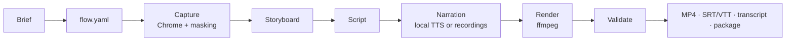

<div align="center">

# Walkthrough

**Turn a feature brief into a narrated, annotated video tutorial of your web app, recorded from the real UI and voiced in your own voice.**


**[Website](https://exiscosoft.github.io/walkthrough/)**

</div>

Walkthrough opens your app in Chrome, follows the steps you describe and captures each screen with sensitive fields already masked. It then highlights the controls involved, drafts narration from the labels it actually saw, voices it locally and renders a 1080p MP4 with captions. It runs from a command line, or Claude Code can drive it for you through an agent skill.

> [!NOTE]
> This is a **Phase 1 technical proof**. The full pipeline works and is tested end to end. Local voice cloning has not yet passed its benchmark on 8 GB machines (see [Speech engines](#speech-engines)), so for now importing your own recordings is the reliable narration path.

## Contents

- [Features](#features)
- [How it works](#how-it-works)
- [Requirements](#requirements)
- [Installation](#installation)
- [Quick start](#quick-start)
- [Using it with Claude Code](#using-it-with-claude-code)
- [Writing a flow](#writing-a-flow)
- [CLI reference](#cli-reference)
- [Speech engines](#speech-engines)
- [Privacy and safety](#privacy-and-safety)
- [Project structure](#project-structure)
- [Development](#development)
- [Roadmap](#roadmap)
- [Contributing](#contributing)
- [License](#license)
- [Acknowledgements](#acknowledgements)

## Features

- **Grounded in the real UI.** Each step is captured from your running app. Narration can only describe steps that were actually observed, and only claim success once the outcome was captured.
- **Stops instead of guessing.** If a button is missing, a popup appears, the session expires or the page leaves the allowed domains, capture pauses with an error code and a suggested fix. It never invents the remaining steps.
- **Masked at capture time.** Passwords, fields you configure and likely-sensitive content are blacked out before any screenshot is written to disk.
- **Your own voice.** Clone your voice locally with an open model, or import your own recordings with automatic caption timing.
- **Annotated video.** Zoom to the relevant area, dim the surroundings, outline the control and add numbered callouts. Title and closing cards, crossfades, captions and a transcript are included.
- **Fast updates.** Content-addressed assets and per-scene caching mean an edited line regenerates one audio clip and one scene, not the whole video.
- **Review built in.** A storyboard page to review, watermarked previews, and approvals tied to content, so any edit made after approval needs re-approval.
- **Agent-ready.** Every command takes a project directory and returns JSON with `--json`, and a Claude Code skill handles the whole workflow.

## How it works



| Component | Location | Role |
|---|---|---|
| CLI engine | `src/` (TypeScript) | Project files, browser capture (Playwright), masking, annotations, script, rendering (sharp and FFmpeg), validation |
| Speech sidecar | `speech/` (Python) | Local voice cloning and whisper alignment, run as a separate process that exits after each stage to free model memory |
| Agent skill | `skill/walkthrough/` | Workflow instructions that let Claude Code drive the CLI; contains no implementation |

Stages run one at a time, and each stage's output is saved before the next begins. A failed run never overwrites a previously good export.

## Requirements

- macOS on Apple silicon (developed on an M3 with 8 GB)
- [Node.js](https://nodejs.org) 22 or later and [pnpm](https://pnpm.io)
- Google Chrome
- [FFmpeg](https://ffmpeg.org): `brew install ffmpeg`
- Optional, for local speech: [uv](https://docs.astral.sh/uv/) (`brew install uv`), which installs Python 3.11 automatically

## Installation

```sh
git clone <this-repo> walkthrough && cd walkthrough
pnpm install
pnpm build && pnpm link --global      # puts `walkthrough` on your PATH
walkthrough --version
```

Optional local speech engines. Each one gets its own virtualenv under `speech/.venvs/`:

```sh
speech/setup.sh align        # whisper: caption timing for imported recordings (recommended)
speech/setup.sh f5           # F5-TTS (MLX)
speech/setup.sh chatterbox   # Chatterbox (PyTorch MPS)
speech/setup.sh mlxaudio     # mlx-audio: Chatterbox MLX, Qwen3-TTS and others
```

Model weights download on first use.

## Quick start

Start your app locally with demo data, then:

```sh
# 1. Create a project from the brief
walkthrough init dealer.walkthrough \
  --name "Set up your dealer account" \
  --objective "Accept a dealer invitation and set your password" \
  --audience "new dealers" \
  --outcome "Your dealer account is ready" \
  --url http://localhost:3000/invite \
  --redact "[data-customer-id]" \
  --reset-command "pnpm db:seed:demo"

# 2. Describe the steps in dealer.walkthrough/flow.yaml (see "Writing a flow"), then:
walkthrough plan dealer.walkthrough
walkthrough capture dealer.walkthrough               # add --headed if a step needs you to sign in

# 3. Script and narration
walkthrough script draft dealer.walkthrough          # template from observed labels; edit with `script set`
walkthrough voice use dealer.walkthrough --engine import
walkthrough narrate dealer.walkthrough --from-dir recordings/   # <stepId>.wav | .m4a | .aiff

# 4. Review
walkthrough storyboard dealer.walkthrough            # open dealer.walkthrough/storyboard.html
walkthrough render dealer.walkthrough --preview      # watermarked draft

# 5. Approve and export
walkthrough redactions dealer.walkthrough --confirm all   # after checking the masks
walkthrough approve dealer.walkthrough storyboard
walkthrough approve dealer.walkthrough script
walkthrough approve dealer.walkthrough visuals            # confirms the frames are fine to share
walkthrough render dealer.walkthrough
walkthrough export dealer.walkthrough
```

The video, captions and transcript are written to `dealer.walkthrough/exports/latest/`. At any point, `walkthrough status <dir>` shows the current stage and what to do next.

<details>
<summary>Narrate with your cloned voice instead of recordings</summary>

```sh
walkthrough voice enroll --voice me --name "Me" --file me.wav --confirm-own-voice   # 8–15 s of clean speech
walkthrough voice test --voice me --engine f5-mlx       # listen to the sample
walkthrough voice approve --voice me --engine f5-mlx
walkthrough voice use dealer.walkthrough --engine f5-mlx --voice me
walkthrough narrate dealer.walkthrough
```

Voice profiles are stored in `~/.walkthrough/voices/` and never exported. Remove one, and optionally the clips made with it, with `walkthrough voice delete --voice me [--project <dir>]`.

</details>

## Using it with Claude Code

The skill lets Claude Code plan the flow, run the capture, write narration from the evidence and walk you through review. It only contains instructions, so install the CLI first (see [Installation](#installation)).

**Option 1: for one app, shared with your team.** Commit the skill to the app's repository:

```sh
cd /path/to/your-app
mkdir -p .claude/skills
cp -r /path/to/walkthrough/skill/walkthrough .claude/skills/
git add .claude/skills/walkthrough
```

**Option 2: for every repo on your machine.** Install it as a personal skill. A symlink keeps it updated when you pull this repo:

```sh
mkdir -p ~/.claude/skills
ln -s /path/to/walkthrough/skill/walkthrough ~/.claude/skills/walkthrough
```

Start a new Claude Code session in your app and check that `walkthrough` appears in `/skills`. Then ask:

> Make a walkthrough video showing how a dealer accepts an invitation and sets a password.

or run `/walkthrough`. Claude asks you for the brief and stops for your decisions: which data-changing steps to allow, reviewing masks, and the three approvals.

Have these ready before the first run:
- your app running locally with seeded demo data and a demo account
- a command that resets the demo data, such as `pnpm db:seed:demo`
- CSS selectors for fields that must always be masked

Add this to your app's `.gitignore` to keep generated media out of version control but keep the flow:

```gitignore
**/*.walkthrough/*
!**/*.walkthrough/flow.yaml
```

## Writing a flow

`flow.yaml` lists the steps to perform and the state that proves each one worked. Use semantic locators (`{role, name}`, `{label}`, `{text}`, `{testId}`). Use `{css}` only as a last resort.

```yaml
permittedDomains: ["localhost"]                       # navigation anywhere else pauses capture
testData:
  password: { env: DEMO_PASSWORD, sensitive: true }   # secrets come from the environment
signedOutWhen:
  - url: "/login"                                     # how an expired session looks
steps:
  - id: sign-in
    title: Sign in as the demo admin
    action: { type: manual, instructions: "Sign in as demo-admin@example.test" }
    expect: [{ visible: { role: heading, name: "Dashboard" } }]

  - id: open-settings
    title: Open Settings
    action: { type: click, target: { role: link, name: "Settings" } }
    expect: [{ url: "/settings" }]

  - id: password
    title: Choose a password
    action: { type: fill, target: { label: "Password" }, value: "${testData.password}" }

  - id: save
    title: Save
    action: { type: click, target: { role: button, name: "Save changes" } }
    sideEffect: mutating        # changes data...
    allow: true                 # ...and is safe on demo data
    expect: [{ text: "Settings saved" }]

  - id: done
    title: Changes saved
    action: { type: observe, target: { text: "Settings saved" } }
    outcome: true               # this step's screen proves the tutorial's outcome
```

| Key | Meaning |
|---|---|
| `action.type` | `goto`, `click`, `fill`, `select`, `check`, `scroll`, `observe`, `manual` |
| `expect` | Assertions that must hold after the action: `visible`, `hidden`, `url` (regex), `text` |
| `sideEffect: mutating` | The step changes data. It needs `allow: true` and is never replayed without `--reset` unless it is also marked `idempotent: true`. Clicks labelled like *Delete*, *Send* or *Purchase* are treated as mutating automatically. |
| `outcome: true` | The step whose screen proves the result. Narration can't claim success before it. |
| `manual` | A step a person completes in a `--headed` browser, such as sign-in. It needs an `expect` list showing the person has finished. It is skipped when that already holds, for example when the saved browser profile is still signed in. Until the last manual step has run, matching `signedOutWhen` is expected and doesn't pause capture. |
| `narration` | Optional narration for the step. Re-planning applies it unless the step's narration was edited elsewhere since, and a change to this text always wins. |
| `dialogExpected: true` | Allow a modal that is open at this step |

[`test/fixture-app/flow.yaml`](test/fixture-app/flow.yaml) is a complete working example.

## CLI reference

All commands take a project directory and support `--json`, which returns `{ok, status, command, data, warnings, errors}`. The exit code is `0` for success, `2` when paused for a person, and `1` for an error.

| Command | Description |
|---|---|
| `init <dir>` | Create a project from the brief |
| `plan <dir> [--request]` | Import `flow.yaml`. `--request` writes a planning bundle (brief, masked screenshot, accessibility snapshot) for an agent |
| `capture <dir> [--step id] [--all] [--headed] [--reset]` | Capture steps. Earlier steps are replayed to reach the right state |
| `script draft\|show\|set\|export\|import <dir>` | Draft and edit narration |
| `pronounce <dir> <term> <spoken>` | Pronunciation override. Changes the speech only, not the captions |
| `annotate <dir> --step id [--move\|--remove\|--add\|--crop\|--reset]` | Edit highlights and zoom. A custom crop must lie inside the screenshot and is widened to 16:9 so nothing in it is cut |
| `redactions <dir> [--confirm ids\|all]` | Review masks |
| `voice enroll\|test\|approve\|show\|delete\|use` | Manage your voice profile and the project's narration engine |
| `narrate <dir> [--step id] [--from-dir dir]` | Generate or import audio for clips that are missing or out of date |
| `storyboard <dir>` | Write `storyboard.html` for review |
| `approve <dir> storyboard\|script\|visuals` | Approve the current content |
| `render <dir> [--preview] [--revision n]` | Render the MP4, captions and transcript |
| `validate <dir>` | List everything blocking a final export |
| `status <dir>` | Current stage, out-of-date items and the next action |
| `export <dir>` | Package the latest final render |
| `bench speech` | Benchmark local voice engines on this machine |

When capture pauses, it reports one of these codes along with a hint:

| Code | Meaning |
|---|---|
| `LOCATOR_NOT_FOUND`, `AMBIGUOUS_LOCATOR` | The UI changed or the locator is too loose. The hint lists labels that are present |
| `UNEXPECTED_DIALOG` | A browser dialog or modal appeared that the flow doesn't expect |
| `OFF_ALLOWLIST_NAVIGATION` | Navigation outside `permittedDomains` |
| `AUTH_EXPIRED` | A `signedOutWhen` condition matched |
| `CAPTCHA` | Bot protection appeared |
| `MANUAL_TAKEOVER_REQUIRED` | A manual step needs `--headed` |
| `MUTATING_ACTION_NOT_ALLOWED` | A data-changing step lacks `allow: true` |
| `REPLAY_REQUIRES_RESET` | Reaching this step would repeat a data change. Rerun with `--reset` |
| `EXPECTATION_FAILED`, `OUTCOME_UNVERIFIED` | The page didn't reach the expected state |

## Speech engines

| Engine | Runtime | Licence | Notes |
|---|---|---|---|
| `import` | none | n/a | Your own recordings, with whisper word timings for captions. **Recommended for now.** |
| `f5-mlx` | [f5-tts-mlx](https://github.com/lucasnewman/f5-tts-mlx) | Code MIT, **weights CC-BY-NC-4.0** | Needs a transcript of the reference clip |
| `chatterbox` | [Chatterbox](https://github.com/resemble-ai/chatterbox), PyTorch MPS | MIT | Outputs carry Resemble's Perth watermark |
| `mlx-audio` | [mlx-audio](https://github.com/Blaizzy/mlx-audio) | Varies by model | e.g. `mlx-community/Chatterbox-TTS-fp16` (MIT), `mlx-community/Qwen3-TTS-12Hz-0.6B-Base-bf16` (Apache-2.0) |

Caption alignment uses `mlx-community/whisper-small.en-mlx` (MIT). No weights ship with this repository. Each engine downloads its model on first use, and that model keeps its own licence. Check the model card before you use generated audio commercially. [NOTICE](NOTICE) has the full list.

**Benchmark your machine.** Close memory-heavy apps first:

```sh
walkthrough bench speech --scripts 30s,3min
walkthrough bench speech --engines f5-mlx --voice me
```

This writes `bench/results/<time>.json` and regenerates [`docs/speech-benchmark.md`](docs/speech-benchmark.md), recording cold start, real-time factor, peak memory footprint, swap use and word error rate. On an 8 GB machine already under memory pressure, both cloning engines tested so far were too slow, so the benchmark is a gate before choosing a default engine.

## Privacy and safety

- **Local by default.** Capture, speech and rendering run on your machine. The only network access is to your app and, the first time, to download model weights.
- **Agent mode.** When Claude Code reads evidence to write the plan or the script, the masked screenshots and accessibility snapshots go to your model provider. The skill says so up front. If you'd rather avoid that, write `flow.yaml` and the script yourself.
- **Masking.** Screenshots are masked before they are saved. No unmasked screenshot is ever written. Typed secrets and masked field values are removed from evidence text. Masks the engine is less sure about block export until a person confirms them.
- **Guardrails.** A domain allowlist, a pause before data-changing actions, and no replay of those actions without a reset.
- **Secrets stay out of projects.** Browser profiles and voice references live in `~/.walkthrough/`. Export packages never include profiles, voices, revision history or evidence.
- **Consent.** Voice enrolment requires `--confirm-own-voice`, and a voice can't be used until you've listened to and approved a sample.

## Project structure

```
src/
  cli.ts            command-line entry point
  project/          manifest schema, versioned store, invalidation, planning, review
  capture/          Playwright adapter, locators, guards, layout stability, masking
  annotate/         highlight and crop suggestions, SVG overlays
  script/           template drafting, checks that narration matches the evidence
  speech/           sidecar client, voice profiles, narration
  render/           timeline, cached scene segments, assembly, captions
  validate/         pre-export and output checks
  bench/            speech benchmark
speech/             Python speech sidecar (one virtualenv per engine)
skill/walkthrough/  Claude Code skill
test/               unit and end-to-end tests, fixture app, stub speech sidecar
docs/               benchmark findings
```

Each video project is a directory such as `dealer.walkthrough/` containing:
- `project.json` and `flow.yaml`
- `revisions/`: an immutable snapshot for every change
- `artifacts/`: content-addressed screenshots and audio
- `evidence/`: what the agent reads
- `renders/` and `exports/`

## Development

```sh
pnpm dev <command>   # run the CLI from source
pnpm typecheck
pnpm test            # unit + end-to-end tests (headless Chrome, FFmpeg, macOS `say`)
pnpm fixture         # run the fixture app on http://127.0.0.1:4310/invite
```

The fixture app simulates failures with `?fixture=renameButton|expire|modal|slow`. The speech tests use a stub sidecar, so they need no model weights.

## Roadmap

- [x] **Phase 1 – technical proof.** CLI engine, capture and masking, rendering, recorded narration, speech sidecar, benchmark harness, agent skill
- [ ] Clean speech benchmark on M3 / 8 GB and a decision on the default engine
- [ ] Proof run on a real pilot app
- [ ] **Phase 2 – MVP.** Interactive storyboard editor, brand presets, privacy review UI
- [ ] **Phase 3 – pilot.** 3–5 marketers, 10+ tutorials
- Later: continuous screen recording, multilingual narration, scheduled recapture when the UI changes

## Contributing

Issues and pull requests are welcome. Before opening a pull request:

1. Run `pnpm typecheck && pnpm test`.
2. Add a test for any behaviour change. New capture behaviour should get a fixture-app scenario.
3. Keep implementation out of the skill. It should stay instructions only.

## License

Walkthrough is released under the [MIT License](LICENSE). Copyright (c) 2026 Exisco.

The MIT License covers this repository's code only. Speech models, runtimes and tools such as FFmpeg and Chrome are downloaded or installed separately and keep their own licences. Some are more restrictive. The F5-TTS weights, for example, are CC-BY-NC-4.0 and can't be used commercially. [NOTICE](NOTICE) lists each model, its licence and its restrictions.

## Acknowledgements

Built on [Playwright](https://playwright.dev), [FFmpeg](https://ffmpeg.org), [sharp](https://sharp.pixelplumbing.com), [Chatterbox](https://github.com/resemble-ai/chatterbox), [F5-TTS](https://github.com/SWivid/F5-TTS) / [f5-tts-mlx](https://github.com/lucasnewman/f5-tts-mlx), [mlx-audio](https://github.com/Blaizzy/mlx-audio) and [Whisper](https://github.com/openai/whisper) via [mlx-whisper](https://github.com/ml-explore/mlx-examples).

The [website](https://exiscosoft.github.io/walkthrough/)'s visual direction is adapted from a reference on [unslop.site](https://unslop.site).
